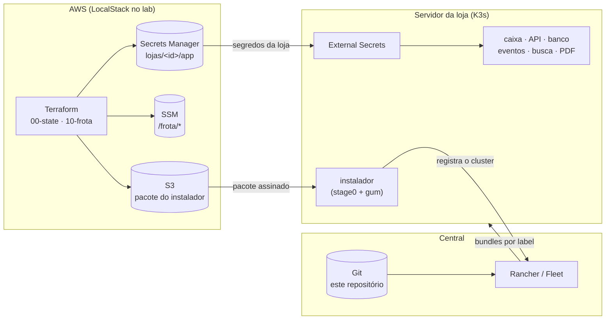
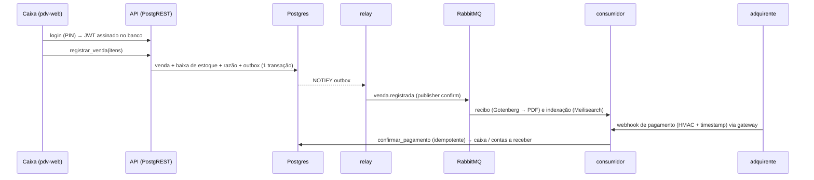

# k3s-gitops-edge

Estudo que reproduz, do zero e com ferramentas abertas, a operação de uma frota de lojas: cada loja tem um servidor pequeno com **K3s**, recebe tudo por **GitOps** e continua vendendo quando a internet cai. Nenhum técnico de TI precisa ir à loja, e nenhuma senha passa pelo git.

[](https://github.com/omatheusgit/k3s-gitops-edge/actions/workflows/ci.yml)
[](https://github.com/omatheusgit/k3s-gitops-edge/actions/workflows/e2e.yml)
[](https://github.com/omatheusgit/k3s-gitops-edge/actions/workflows/seguranca.yml)
[](https://github.com/omatheusgit/k3s-gitops-edge/actions/workflows/rancher.yml)


## Stack

| Camada | Ferramentas |
| :-- | :-- |
| Nuvem (IaC) | Terraform, Atlantis (plano e apply no PR), AWS: Secrets Manager, IAM, SSM, S3 |
| Central | Rancher Fleet (ou Rancher completo), GitOps a partir deste repositório |
| Servidor da loja | K3s, Traefik, External Secrets, instalador em Bash + Gum |
| Aplicação (o caixa) | PostgREST, Postgres, RabbitMQ, Redis, Meilisearch, Gotenberg, serviço de eventos em Python |
| Laboratório e CI | k3d, LocalStack, GitHub Actions, Sigstore (instalador assinado) |

## Como funciona




1. **Terraform** cria, por loja, as senhas no Secrets Manager e um usuário IAM que só lê o que é daquela loja.
2. **Instalador:** o técnico roda o `stage0.sh` no servidor novo. Ele confere a assinatura do pacote, instala o K3s e registra a loja na central.
3. **Fleet** entrega os bundles conforme os labels de cada loja (`perfil=enxuto`, por exemplo, não leva busca nem PDF).
4. **External Secrets** busca na AWS só os segredos da própria loja.
5. **O caixa** roda inteiro no servidor da loja: venda, estoque e razão contábil no Postgres, eventos pelo RabbitMQ, recibo em PDF e pagamento por webhook.




## Como usar

### No GitHub Actions, sem instalar nada

- **[e2e](https://github.com/omatheusgit/k3s-gitops-edge/actions/workflows/e2e.yml):** a cada PR, sobe a nuvem, a central e duas lojas e testa o fluxo de venda inteiro, inclusive derrubando o banco e cortando a internet da loja.
- **[demo](https://github.com/omatheusgit/k3s-gitops-edge/actions/workflows/demo.yml):** simula um dia de loja e publica o relatório no resumo do job ([exemplo](https://github.com/omatheusgit/k3s-gitops-edge/actions/runs/43348527867)). Com `manter_no_ar`, o caixa fica num link público temporário enquanto o job roda.
- **[rancher](https://github.com/omatheusgit/k3s-gitops-edge/actions/workflows/rancher.yml):** o mesmo, com o Rancher completo na central.
- **Atlantis:** o [PR #4](https://github.com/omatheusgit/k3s-gitops-edge/pull/4) abre uma loja nova com o plano e o apply comentados pelo Atlantis.

### Na sua máquina

Requisitos: Docker, `make`, git, curl, openssl, jq, k3d, kubectl, helm, terraform ≥ 1.9 e bash ≥ 4. Testado em Linux e WSL; no macOS precisa do bash do Homebrew (`brew install bash`) e não foi testado. Cerca de 4 GB de RAM livres para o modo leve (central só com Fleet). O aws-cli não precisa estar instalado: o lab usa a imagem oficial em container.

```bash
make up        # LocalStack + Terraform + central (Fleet) + loja-001 pelo instalador, pronta
make e2e       # login, venda, recibo PDF, busca, webhook, razão
make demo      # um dia de movimento (VENDAS=60) e o relatório em Markdown
make down
```

Por partes: `make nuvem`, `make central MODO=fleet|rancher`, `make loja LOJA=loja-002 PORTA=8081`. O modo Rancher pede ~3 GB a mais e a linha `127.0.0.1 rancher.lab.internal` no `/etc/hosts`. Com a loja no ar:

| URL | O quê |
| :-- | :-- |
| http://pdv.localhost:8080 | tela do caixa (`caixa1` / PIN `1234`, operador de demonstração que só existe no lab) |
| http://whoami.localhost:8080 | diagnóstico de ingress |

O painel do RabbitMQ não passa pela borda: `kubectl -n loja port-forward pod/rabbitmq-0 15672` e http://localhost:15672.

Sem cluster: `make lint` roda shellcheck, renderização dos bundles, as [políticas do repositório](scripts/verificar-politicas.py), `terraform validate` e os testes do serviço de eventos.

## Estrutura

```
terraform/     00-state (state + lock) · 10-frota (segredos, IAM, SSM, S3)
installer/     stage0.sh + instalar.sh (gum) + lib/
central/       GitRepo da frota e token de registro do Fleet
platform/      bundles 00 a 40 (rede, ESO, secret store, contexto da loja, ingress)
apps/          postgres, api, pdv-web, busca, rabbitmq, redis, gotenberg, eventos + perfis
src/eventos/   relay do outbox, consumidores e gateway de webhook (Python)
smoke/         whoami e podinfo (só no lab)
lab/           nuvem, central, loja, atlantis, git e e2e
scripts/       políticas do repo, empacotar/publicar instalador
```

## Mais

- [Decisões e limites](docs/decisoes.md) · [Aprendizados](docs/aprendizados.md) · [Arquitetura](docs/arquitetura.md) · [Segurança](SECURITY.md) · [CHANGELOG](CHANGELOG.md)
- Estudo pessoal de [Matheus Santana](https://github.com/omatheusgit), sobre um tipo de problema com que já trabalhei; nenhum código, nome ou dado de ambiente real foi reutilizado. O histórico até a v1.0.0 foi reorganizado a partir do trabalho local; daí em diante tudo entra por issue e PR.
