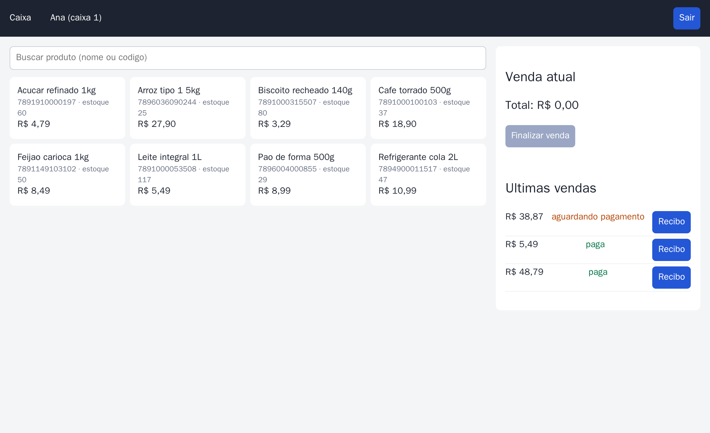
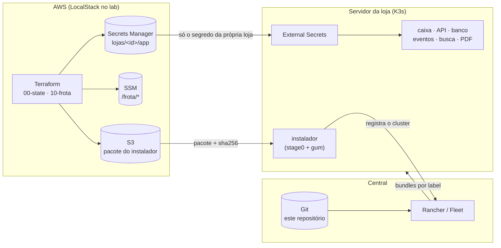
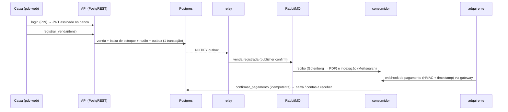
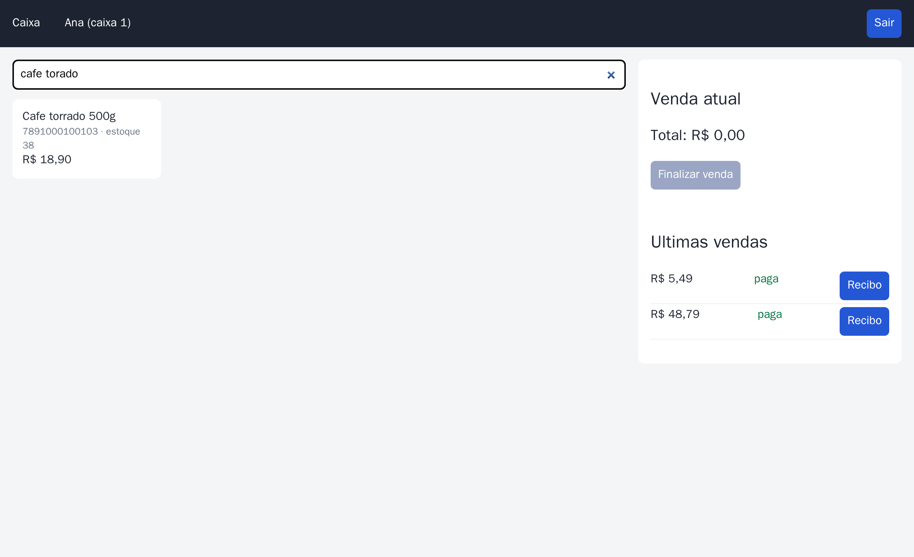
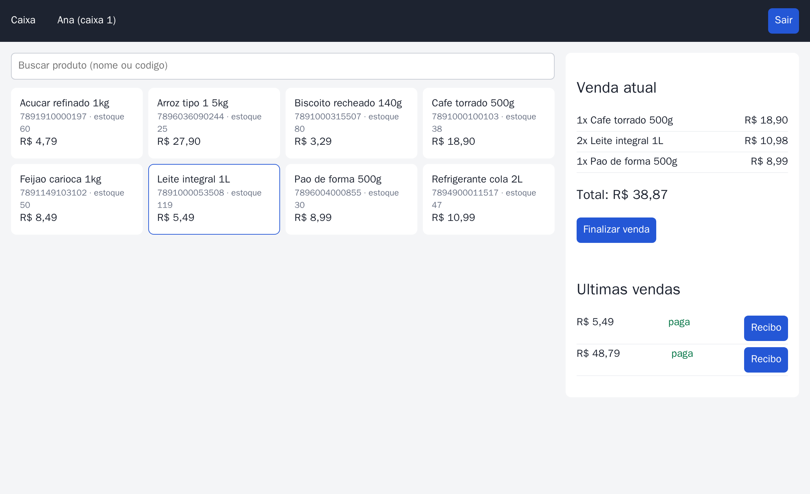

# k3s-gitops-edge

Uma rede de lojas em que cada loja tem um servidor pequeno rodando **K3s**, recebe tudo por **GitOps (Rancher Fleet)**, busca os próprios segredos na **AWS (Secrets Manager via External Secrets)** e continua vendendo mesmo sem internet.

O repositório tem a frota inteira: a infraestrutura em nuvem (Terraform + Atlantis), o instalador do servidor da loja, os bundles do Fleet, uma aplicação de caixa que funciona de verdade e um laboratório que sobe tudo num notebook, sem gastar nada de nuvem.

[](https://github.com/omatheusgit/k3s-gitops-edge/actions/workflows/ci.yml)
[](https://github.com/omatheusgit/k3s-gitops-edge/actions/workflows/e2e.yml)
[](https://github.com/omatheusgit/k3s-gitops-edge/actions/workflows/seguranca.yml)
[](https://github.com/omatheusgit/k3s-gitops-edge/actions/workflows/rancher.yml)



<sub>Print tirado pelo próprio CI, numa loja subida pelo laboratório (ver [`lab/testes/captura.py`](lab/testes/captura.py)).</sub>

### Ver funcionando sem instalar nada

- **e2e no Actions**: cada PR sobe LocalStack, Terraform, a central com Fleet e uma loja registrada pelo instalador, e testa venda, recibo, busca, webhook e razão, inclusive derrubando o Postgres no meio ([workflow `e2e`](https://github.com/omatheusgit/k3s-gitops-edge/actions/workflows/e2e.yml)).
- **Atlantis num PR real**: [#4](https://github.com/omatheusgit/k3s-gitops-edge/pull/4) abre uma loja nova; o Atlantis comenta o `plan`, o `apply` sai por comentário, e o plano foi corrigido no meio do PR porque mexia nas outras lojas.
- **Um dia de loja**: o [workflow `demo`](https://github.com/omatheusgit/k3s-gitops-edge/actions/workflows/demo.yml) sobe a mesma loja e simula o movimento: mais de cem vendas de dois operadores, pagamentos chegando (alguns em dobro), estoque acabando. O relatório (faturamento, latência, razão por conta, filas) aparece no resumo do job, e o dump do banco fica como artefato.
- **Modo Rancher**: [workflow `rancher`](https://github.com/omatheusgit/k3s-gitops-edge/actions/workflows/rancher.yml) sobe o Rancher 2.15 e importa a loja pelo instalador.

---

## De onde veio

Trabalhei com um problema desse tipo: dezenas de servidores Linux em unidades remotas, cada um com seu K3s, instalados por técnicos de campo e gerenciados de forma centralizada. Este repositório é um **estudo pessoal** que reconstrói esse tipo de arquitetura do zero, com ferramentas abertas e um domínio fictício (varejo), para praticar e documentar as decisões. Nenhum código, nome ou dado de ambiente real foi reutilizado.

O caminho não foi linear: muita coisa que passava no lint quebrava ao subir de verdade, e esses problemas estão em [Aprendizados](#aprendizados) (cada um tem o seu commit `fix:` no histórico). Dou o projeto como finalizado e o mantenho como portfólio.

| | |
| :-- | :-- |
| **O quê** | Plataforma para provisionar e operar clusters K3s de borda com GitOps, e uma aplicação de caixa de exemplo rodando em cima. |
| **Por quê** | Instalar e atualizar dezenas de servidores sem acesso manual a cada um, sem segredo no git e sem a loja parar quando o link cai. |
| **Onde** | Servidor da loja (K3s, 4–8 GB) + central (Rancher/Fleet) + AWS (S3, SSM, Secrets Manager, IAM). No laboratório: k3d + LocalStack. |
| **Quem** | Projeto individual: [Matheus Santana](https://github.com/omatheusgit). |
| **Como** | Terraform cria segredos e identidades por loja; o instalador registra o servidor na central; o Fleet entrega os bundles conforme os labels do cluster. |
| **Quanto** | Zero de nuvem no laboratório. Na AWS, o custo é de Secrets Manager e S3 (centavos por loja). |

## Como funciona



1. **Terraform** (`terraform/`) cria, para cada loja, senhas aleatórias no Secrets Manager, um usuário IAM que só lê o segredo daquela loja, os parâmetros do instalador no SSM e o bucket do pacote. Nenhuma senha passa pelo git. O Atlantis roda `plan` e `apply` nos PRs.
2. **Instalador** (`installer/`): o técnico roda o `stage0.sh` no servidor novo. Ele baixa o pacote do S3 com a chave da loja, confere o sha256 e abre um menu em [Gum](https://github.com/charmbracelet/gum). O menu instala o K3s em versão fixa, grava a chave AWS no cluster e registra a loja na central (Rancher, ou Fleet sem Rancher).
3. **Fleet** (`central/gitrepo.yaml`): um único GitRepo para a frota. Cada loja recebe os bundles conforme os labels do próprio cluster (`perfil=enxuto` não leva busca nem PDF; `ambiente=lab` aponta o ESO para o LocalStack).
4. **Plataforma** (`platform/`): cinco bundles em ordem (`dependsOn`), cobrindo políticas de rede e cotas, External Secrets, um `ClusterSecretStore` restrito ao namespace da loja, o contexto da loja (um chart Helm alimentado pelos labels) e os middlewares do Traefik.
5. **Aplicação** (`apps/` + `src/eventos`): o caixa.

### O caixa



- **Banco como contrato**: o PostgREST expõe só o schema `api`, com views e funções e nenhuma tabela direta. O login gera um JWT HS256 dentro do Postgres (pgcrypto), com a mesma chave que o PostgREST valida.
- **Razão em partidas dobradas**: cada venda e cada pagamento geram lançamentos que somam zero; o e2e confere isso.
- **Transactional outbox**: o evento nasce na mesma transação da venda. O relay usa `FOR UPDATE SKIP LOCKED` e entrega pelo menos uma vez, e os consumidores são idempotentes.
- **Webhook**: HMAC-SHA256 sobre `timestamp.corpo`, janela de 5 minutos contra replay, e deduplicação por id do evento.
- **Busca**: o nginx do caixa só repassa `POST /indexes/{produtos,vendas}/search` para o Meilisearch e injeta a chave do lado do servidor; o Traefik exige JWT antes (forwardAuth na própria API).

| Busca tolerante a erro de digitação | Venda montada no caixa |
| :-: | :-: |
|  |  |

## Rodando

Requisitos: Docker, `make`, k3d, kubectl, helm, terraform e jq. Uns 4 GB de RAM livres para o modo leve (central só com Fleet). O aws-cli não precisa estar instalado: o lab usa a imagem oficial em container.

```bash
make up        # LocalStack + Terraform + central (Fleet) + loja-001 pelo instalador
make e2e       # login, venda, recibo PDF, busca, webhook, razão
make demo      # um dia de movimento (VENDAS=60) e o relatório em Markdown
make down
```

Por partes: `make nuvem`, `make central MODO=fleet|rancher`, `make loja LOJA=loja-002 PORTA=8081`. O modo Rancher pede ~3 GB a mais e a linha `127.0.0.1 rancher.lab.internal` no `/etc/hosts`. Com a loja no ar:

| URL | O quê |
| :-- | :-- |
| http://pdv.localhost:8080 | tela do caixa (`caixa1` / PIN `1234`) |
| http://rabbit.localhost:8080 | painel do RabbitMQ |
| http://whoami.localhost:8080 | diagnóstico de ingress |

Sem cluster: `make lint` roda shellcheck, renderização dos bundles, as [políticas do repositório](scripts/verificar-politicas.py), `terraform validate` e os testes do serviço de eventos.

## Decisões

| Decisão | Por quê | Custo |
| :-- | :-- | :-- |
| **Fleet** e não Argo CD | Pensado para muitos clusters pequenos: o agente na loja puxa da central (só conexão de saída), e o alvo é escolhido por label. | Feedback mais lento: o `dependsOn` reavalia a cada alguns minutos. |
| **ESO com um store por loja** | A chave AWS fica num namespace que as aplicações não leem; a policy IAM só abre `lojas/<id>/*`. | Senha nova no Secrets Manager não muda a do banco já inicializado (rotação exige migração). |
| **Liveness só por TCP** | Liveness que consulta banco reinicia a loja inteira quando o banco oscila. Readiness pode depender do banco. | Um processo travado com a porta aberta demora mais a ser detectado. |
| **PostgREST** em vez de API escrita à mão | Regras de negócio no banco, perto dos dados, e funcionando offline; o JWT é validado sem serviço extra. | A lógica fica em SQL. |
| **Outbox + RabbitMQ** | Venda e evento atômicos; recibo e indexação podem falhar e tentar de novo sem perder a venda. | Entrega pelo menos uma vez, então tudo precisa ser idempotente. |
| **Namespaces criados pelo instalador** | Namespace com banco não pode sumir junto com um release do Helm (ver Aprendizados). | Os labels de Pod Security desses namespaces ficam fora do GitOps. |
| **Migrações no `initContainer` da API** | No PostgREST o esquema é a API: ela só sobe com o banco na versão certa. Migração nova muda o hash do ConfigMap e o rollout aplica sozinho. | A API depende de o banco estar no ar para subir (o dbmate espera até 5 min). |
| **Rancher opcional** | O Fleet sozinho cabe em ~1 GB; o Rancher dá UI, RBAC e o import de clusters, mas pesa ~2,5 GB. | Dois caminhos de registro no instalador. |

## Aprendizados

Coisas que só apareceram subindo de verdade (os detalhes estão nos PRs):

- **Um namespace com dados apagado por um redeploy.** Com o namespace da loja ligado a um release do Helm, um redeploy forçado do Fleet recriou o namespace e levou junto o banco e os volumes. Agora o namespace é do instalador e os bundles com estado usam `keepResources`.
- **Um Service chamado `api` derrubou o Gotenberg.** O Kubernetes injeta `API_PORT=tcp://...` em todo pod do namespace, e o Gotenberg lê `API_PORT` como a própria porta. Resolvido com `enableServiceLinks: false` em todos os pods, e hoje a CI cobra isso.
- **Chromium não sobe com o sistema de arquivos somente leitura** sem `XDG_CONFIG_HOME` e `XDG_CACHE_HOME` graváveis. Também cortei toda resolução de nomes dele: o recibo não precisa de rede, e isso fecha SSRF.
- **Argumentos de fila no RabbitMQ são imutáveis.** Mudar o limite de entregas quebrou a declaração da fila; limite e fila de mortos foram para uma *policy*.
- **Ruído local escondendo bug.** No notebook, o recibo em PDF falhava e a culpa parecia ser a CPU saturada deixando o Chromium lento. No runner do GitHub, com CPU livre, a mesma falha mostrou a causa real: `INSERT ... ON CONFLICT DO UPDATE` exige `SELECT` na tabela, e o papel do worker não tinha. Hoje o e2e roda no Actions a cada PR justamente por isso.
- **`/dev/tty` existe mesmo sem terminal.** Dentro de container (ou via cron) o `stage0.sh` achava que podia perguntar a chave e quebrava no `read`; agora testa abrindo o tty de fato.
- **Volume que não sobrevive a restart.** Com `fsGroup`, o kubelet reaplicava permissão de grupo no volume a cada montagem: o cookie do Erlang virou `0660` e o RabbitMQ não voltou mais (o Postgres teria o mesmo problema com o `PGDATA`). `fsGroupChangePolicy: OnRootMismatch` resolve, e a CI passou a exigir.
- **Consumidor "pronto" e parado.** Depois de um restart do Postgres, o consumidor seguia tentando na conexão fechada, sem reconectar. Agora erro de conexão interrompe o consumo e o laço reconecta; o e2e derruba o Postgres de propósito para provar.
- **Disco do runner.** O modo Rancher passava no tamanho, mas o kubelet despejava o pod por *DiskPressure* com tanta imagem no runner do GitHub. O mesmo problema voltou disfarçado nos prints do caixa: falhavam "às vezes", e só quando a captura passou a registrar a resposta apareceu o 503 do Traefik, o `pdv-web` despejado e o nó com *taint* de disco. Todo workflow que sobe o lab libera espaço antes.
- **Plano do Terraform que assusta.** Abrir uma loja fazia o plano "alterar" a policy IAM das outras: um `data` com `for_each` depende do recurso inteiro. Com `jsonencode` o plano mostra só o que muda de verdade.
- **Segredo demais em cada pod.** Os workers recebiam o Secret inteiro (inclusive a senha de superusuário); agora cada container recebe só as chaves que usa, e `envFrom` de Secret é barrado na CI.
- **Job verde sem ter rodado.** A primeira versão do `demo` passou no Actions com o relatório vazio: o script morria na primeira venda (um `read` sem quebra de linha no fim e o `set -e`), e o `| tee` do passo escondia a falha, porque o shell padrão do runner é `bash -e` sem `pipefail`. Hoje todo workflow declara `shell: bash`, e o relatório termina com conferências que falham o job.
- **O scanner achou CVE dentro do `pip`.** As bibliotecas vendorizadas no pip da imagem base apareciam como HIGH no Trivy; a imagem final não leva pip, e recebe as correções do Debian no build.

## Limites conhecidos

- O LocalStack Community não aplica IAM, então o isolamento entre lojas só é garantido na AWS de verdade.
- O modo Rancher não roda bem no meu notebook (5 GB de WSL dividido com outros projetos): ele é provado no Actions, pelo workflow `rancher`. No dia a dia uso a central só com Fleet.
- O Atlantis do lab depende de um GitHub App próprio e do `gh webhook forward` aberto no terminal; não é um serviço sempre no ar.
- O recibo em PDF sai um por vez: no runner do Actions, uns 20 por minuto. Num pico, a venda não espera (o recibo é assíncrono), mas a fila de recibos leva alguns minutos para zerar; o workflow `demo` mede isso a cada execução.
- A rotação de senha do banco não é automática (ver Decisões).
- `installer/lib/servidor.sh` (hardening do SO) só rodou em modo `SIMULAR=1`.

## Estrutura

```
terraform/     00-state (state + lock) · 10-frota (segredos, IAM, SSM, S3)
installer/     stage0.sh + instalar.sh (gum) + lib/
central/       GitRepo da frota e token de registro do Fleet
platform/      bundles 00 a 40 (rede, ESO, secret store, contexto da loja, ingress)
apps/          postgres, api, pdv-web, busca, rabbitmq, redis, gotenberg, eventos + perfis
src/eventos/   relay do outbox, consumidores e gateway de webhook (Python)
smoke/         whoami e podinfo (só no lab)
lab/           nuvem, central, loja, atlantis, git e e2e
scripts/       políticas do repo, empacotar/publicar instalador
```

Mais detalhes em [docs/arquitetura.md](docs/arquitetura.md) e no [CHANGELOG](CHANGELOG.md).
