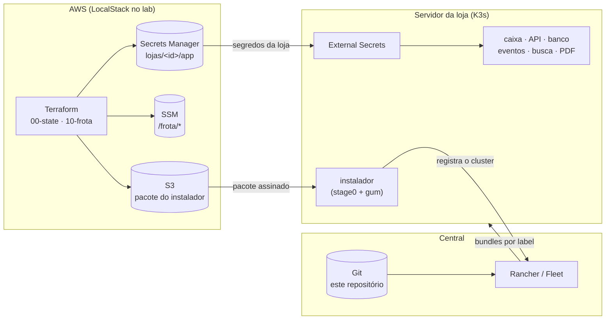
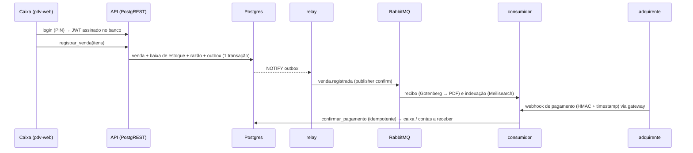

# k3s-gitops-edge

[](https://github.com/omatheusgit/k3s-gitops-edge/actions/workflows/ci.yml)
[](https://github.com/omatheusgit/k3s-gitops-edge/actions/workflows/e2e.yml)
[](https://github.com/omatheusgit/k3s-gitops-edge/actions/workflows/seguranca.yml)
[](https://github.com/omatheusgit/k3s-gitops-edge/actions/workflows/rancher.yml)


<sub>Captura de tela gerada pelo próprio CI, numa loja subida pelo laboratório (ver [`lab/testes/captura.py`](lab/testes/captura.py)).</sub>

---

## De onde veio

Já trabalhei com frotas de servidores K3s espalhados em locais remotos e gerenciados de forma centralizada. Este repositório é um **estudo pessoal** que reconstrói esse tipo de arquitetura do zero, com ferramentas abertas e um domínio fictício (varejo), para praticar e documentar as decisões. Nenhum código, nome ou dado de ambiente real foi reutilizado.

O caminho não foi linear: muita coisa que passava no lint quebrava ao subir de verdade, e esses problemas estão em [Aprendizados](#aprendizados), cada um com a correção no histórico. O projeto é mantido como portfólio: achados (inclusive os de revisões adversariais) viram issue, e a correção entra por PR.

Sobre o histórico: até a v1.0.0 o trabalho foi local, e os commits desse período foram reorganizados por tema na hora de publicar, com datas aproximadas. A partir da v1.1.0 (novembro de 2026), tudo entra por issue e PR aqui no GitHub, com o CI rodando.

| | |
| :-- | :-- |
| **O quê** | Plataforma para provisionar e operar clusters K3s de borda com GitOps, e uma aplicação de caixa de exemplo rodando em cima. |
| **Por quê** | Instalar e atualizar dezenas de servidores sem acesso manual a cada um, sem segredo no git e sem a loja parar quando o link cai. |
| **Onde** | Servidor da loja (K3s, 4–8 GB) + central (Rancher/Fleet) + AWS (S3, SSM, Secrets Manager, IAM). No laboratório: k3d + LocalStack. |
| **Quem** | Projeto individual: [Matheus Santana](https://github.com/omatheusgit). |
| **Como** | Terraform cria segredos e identidades por loja; o instalador registra o servidor na central; o Fleet entrega os bundles conforme os labels do cluster. |
| **Quanto** | Custo zero de nuvem no laboratório. Na AWS: Secrets Manager (cerca de US$ 0,40/mês por segredo) e S3; a central roda num servidor próprio. |

## Como funciona



1. **Terraform** (`terraform/`) cria, para cada loja, senhas aleatórias no Secrets Manager, um usuário IAM que lê só o segredo daquela loja, o próprio registro na central e a credencial comum do registro de imagens (`frota/registry`), os parâmetros do instalador no SSM e o bucket do pacote. Nenhuma senha passa pelo git. O Atlantis roda `plan` e `apply` nos PRs.
2. **Instalador** (`installer/`): o técnico roda o `stage0.sh` no servidor novo. Ele instala o que faltar (curl, jq, aws cli), baixa o pacote do S3 com a chave da loja, só aceita o pacote se a assinatura (Sigstore) for do workflow de release deste repositório numa tag de versão, e abre um menu em [Gum](https://github.com/charmbracelet/gum) (sem o Gum, um menu simples do bash). O menu instala o K3s em versão fixa, grava a chave AWS no cluster e registra a loja na central (Rancher, ou Fleet sem Rancher).
3. **Fleet** (`central/gitrepo.yaml`): um único GitRepo para a frota. Cada loja recebe os bundles conforme os labels do próprio cluster (`perfil=enxuto` não leva busca nem PDF; `ambiente=lab` aponta o ESO para o LocalStack).
4. **Plataforma** (`platform/`): cinco bundles em ordem (`dependsOn`), cobrindo políticas de rede e cotas, External Secrets, um `ClusterSecretStore` restrito ao namespace da loja, o contexto da loja (um chart Helm alimentado pelos labels) e os middlewares do Traefik.
5. **Aplicação** (`apps/` + `src/eventos`): o caixa.

### O caixa



- **Banco como contrato**: o PostgREST expõe só o schema `api`, com views e funções e nenhuma tabela direta. O login gera um JWT HS256 dentro do Postgres (pgcrypto), com a mesma chave que o PostgREST valida.
- **Razão em partidas dobradas**: cada venda e cada pagamento geram lançamentos que somam zero; o e2e confere isso.
- **Transactional outbox**: o evento nasce na mesma transação da venda. O relay usa `FOR UPDATE SKIP LOCKED` e entrega pelo menos uma vez, e os consumidores são idempotentes.
- **Webhook**: HMAC-SHA256 sobre `timestamp.corpo`, janela de 5 minutos contra replay, e deduplicação por id do evento.
- **Busca**: o nginx do caixa só repassa `POST /indexes/{produtos,vendas}/search` para o Meilisearch e injeta a chave do lado do servidor; o Traefik exige JWT antes (forwardAuth na própria API).

| Busca tolerante a erro de digitação | Venda montada no caixa |
| :-: | :-: |
|  |  |

## Rodando

Requisitos: Docker, `make`, git, curl, openssl, jq, k3d, kubectl, helm, terraform ≥ 1.9 e bash ≥ 4. Testado em Linux e WSL; no macOS precisa do bash do Homebrew (`brew install bash`) e não foi testado. Cerca de 4 GB de RAM livres para o modo leve (central só com Fleet). O aws-cli não precisa estar instalado: o lab usa a imagem oficial em container.

```bash
make up        # LocalStack + Terraform + central (Fleet) + loja-001 pelo instalador, pronta
make e2e       # login, venda, recibo PDF, busca, webhook, razão
make demo      # um dia de movimento (VENDAS=60) e o relatório em Markdown
make down
```

Por partes: `make nuvem`, `make central MODO=fleet|rancher`, `make loja LOJA=loja-002 PORTA=8081`. O modo Rancher pede ~3 GB a mais e a linha `127.0.0.1 rancher.lab.internal` no `/etc/hosts`. Com a loja no ar:

| URL | O quê |
| :-- | :-- |
| http://pdv.localhost:8080 | tela do caixa (`caixa1` / PIN `1234`, operador de demonstração que só existe no lab) |
| http://whoami.localhost:8080 | diagnóstico de ingress |

O painel do RabbitMQ não passa pela borda: `kubectl -n loja port-forward pod/rabbitmq-0 15672` e http://localhost:15672.

Sem cluster: `make lint` roda shellcheck, renderização dos bundles, as [políticas do repositório](scripts/verificar-politicas.py), `terraform validate` e os testes do serviço de eventos.

### Ver funcionando sem instalar nada

- **e2e no Actions**: todo PR que mexe em código sobe LocalStack, Terraform, a central com Fleet e duas lojas registradas pelo instalador (perfil completo e enxuto), e testa venda, recibo, busca, webhook (inclusive pagamento com valor errado) e razão, derrubando o Postgres no meio e cortando a internet da loja. Depois troca a chave do webhook na AWS (rotação), faz um commit que tem que chegar sozinho na loja pelo Fleet e roda o instalador de novo na mesma loja ([workflow `e2e`](https://github.com/omatheusgit/k3s-gitops-edge/actions/workflows/e2e.yml)).
- **Atlantis num PR real**: [#4](https://github.com/omatheusgit/k3s-gitops-edge/pull/4) abre uma loja nova; o Atlantis comenta o `plan` e o `apply` sai por comentário (contra o LocalStack do lab). O plano foi corrigido no meio do PR porque mexia nas outras lojas.
- **Um dia de loja**: o [workflow `demo`](https://github.com/omatheusgit/k3s-gitops-edge/actions/workflows/demo.yml) sobe a mesma loja e simula o movimento: mais de cem vendas de dois operadores, pagamentos chegando (alguns em dobro), estoque acabando. O relatório (faturamento, latência, razão por conta, filas) aparece no resumo do job, e o dump do banco fica como artefato. Com `manter_no_ar` (minutos), o caixa fica aberto num link público temporário enquanto o job roda: dá para abrir no navegador numa entrevista, com vendas chegando.
- **Modo Rancher**: [workflow `rancher`](https://github.com/omatheusgit/k3s-gitops-edge/actions/workflows/rancher.yml) sobe o Rancher 2.15 e importa a loja pelo instalador.

## Segurança

O repositório passou por duas revisões adversariais completas (README, segurança, laboratório e CI). Cada achado virou issue (#25 a #36, #44, #51) e foi corrigido por PR, com teste, entre eles:

- **Isolamento entre lojas:** cada loja tem o próprio segredo, a própria chave de JWT, o próprio registro na central (um token que só registra aquele cluster, com identidade secreta no modo Fleet) e um usuário IAM que só lê o que é dela.
- **Dentro da loja:** a rede libera cada serviço só para quem fala com ele; o RabbitMQ tem um usuário por processo, sem permissão de mudar a topologia (o relay não consegue publicar um pagamento); o relay tem papel próprio no banco; o caixa só tem a chave de busca do Meilisearch.
- **Cadeia de suprimentos:** o instalador só executa pacote assinado (Sigstore) pelo workflow de release deste repositório, na versão pedida; k3s e chart do Fleet conferidos por sha256; imagens e actions por digest; state do Terraform com chave KMS própria.

Detalhes em [SECURITY.md](SECURITY.md) e no [CHANGELOG](CHANGELOG.md). O que continua sendo limite está logo abaixo.

## Estrutura

```
terraform/     00-state (state + lock) · 10-frota (segredos, IAM, SSM, S3)
installer/     stage0.sh + instalar.sh (gum) + lib/
central/       GitRepo da frota e token de registro do Fleet
platform/      bundles 00 a 40 (rede, ESO, secret store, contexto da loja, ingress)
apps/          postgres, api, pdv-web, busca, rabbitmq, redis, gotenberg, eventos + perfis
src/eventos/   relay do outbox, consumidores e gateway de webhook (Python)
smoke/         whoami e podinfo (só no lab)
lab/           nuvem, central, loja, atlantis, git e e2e
scripts/       políticas do repo, empacotar/publicar instalador
```

Mais detalhes em [docs/arquitetura.md](docs/arquitetura.md) e no [CHANGELOG](CHANGELOG.md).
